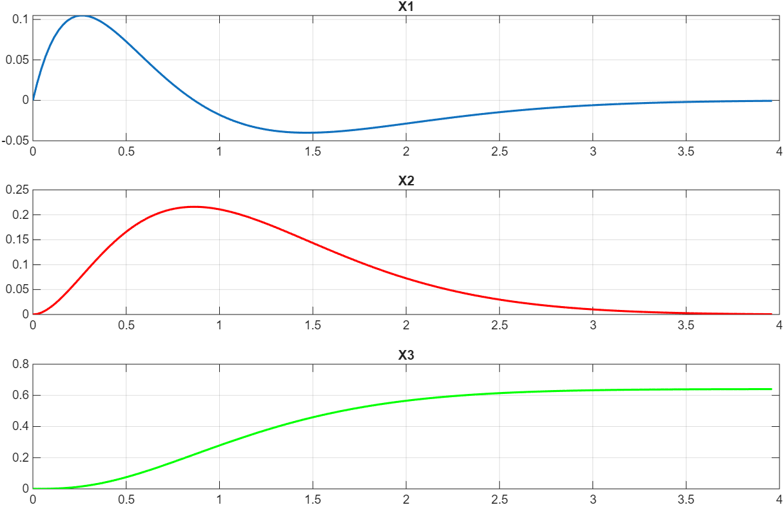
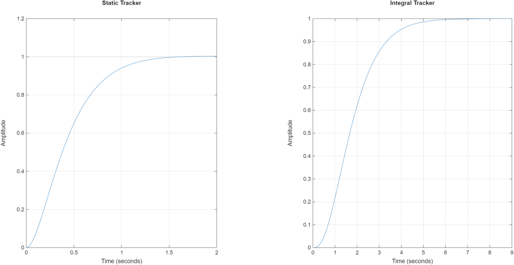
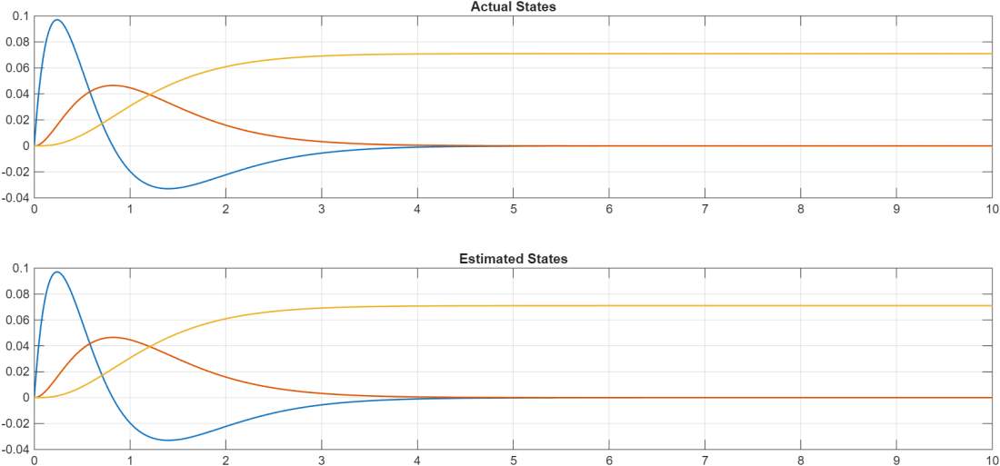
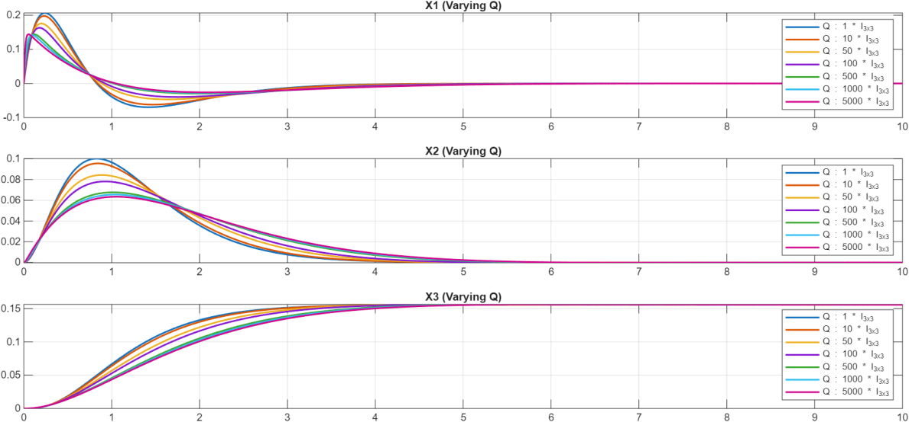

# Modern Control Systems: State-Space Analysis, Observers & LQR

**Third-order dynamic system | MATLAB | State feedback | Tracking | Full- and reduced-order observers | Optimal control**

An extensive undergraduate modern control study spanning **18 analytical and MATLAB simulation sections**. The work explores how a state-space realization supports system-structure analysis, closed-loop pole placement, reference tracking, state estimation, and quadratic optimal feedback.

**Author:** Hannaneh Sadat Ahmadi (`@hanahmdi`)

## Full academic report

**[Read the complete English academic report (PDF)](docs/ACADEMIC_REPORT.pdf)** — a **21-page A4 technical report** with mathematical derivations, the original simulation figures, 18 numbered study descriptions, implementation notes, limitations, and references.

**[Read the report online in Markdown](docs/ACADEMIC_REPORT.md)** — equations and figures with relative paths for GitHub display.

> **Source integrity:** The original MATLAB code was not modified. The original assignment sheet was unavailable, so topics in the English report are reconstructed from the numbered script and submitted research report, not quoted from an official question sheet. All original plots are historical project evidence; this presentation does not claim a new verified MATLAB run.

## Plant

```math
G(s)=\frac{3.6s+6.42}{s^{3}+7.317s^{2}+17.67s+14.08}
```

```math
\dot{x}=Ax+Bu,\qquad y=Cx+Du.
```

## Main study areas

| Modules | Study focus |
| --- | --- |
| **1–6. Fundamental analysis** | Poles, zeros, stability, transfer-to-state conversion, controllability, observability, minimal realization, initial-state and feedback responses |
| **7–10. Feedback & tracking** | Real/complex pole placement, static precompensation, integral reference tracking, and model/disturbance comparisons |
| **11–13. State estimation** | Full-order observer design, sensitivity experiments, and reduced-order state reconstruction |
| **14–17. Integrated controllers** | Observer-based feedback and integral tracking with full- and reduced-order observers |
| **18. Optimal control** | LQR, Riccati-based feedback, and state/input weighting sweeps |

## Selected results from the original report

### State-feedback pole placement



### Static versus integral reference tracking



### State estimation



### Linear Quadratic Regulator



The academic report documents additional illustrations of reduced-order observers, estimation errors, observer-based control, and tracking configurations.

## Repository structure

```text
modern-control-state-space-design/
├── README.md
├── .gitignore
├── matlab/
│   └── code.m                        # Original unchanged MATLAB implementation
├── archive/
│   └── code.asv                      # Original MATLAB autosave backup
└── docs/
    ├── ACADEMIC_REPORT.pdf           # English scholarly portfolio report
    ├── ACADEMIC_REPORT.md            # Readable report source
    └── figures/                     # Extracted original MATLAB figures
```

## How to explore the code

1. Install MATLAB with **Control System Toolbox**.
2. Open `matlab/code.m` in the MATLAB editor.
3. Inspect the numbered `%% Question` sections and execute them in their intended sequence. Several later sections depend on variables prepared earlier.
4. Consult the English academic report for the associated theory, context, and interpretation.

```matlab
run('matlab/code.m');
```

**Validation boundary:** Original figures are preserved from the coursework. A full MATLAB rerun was not performed for the public documentation package; source-level consistency considerations are identified in the report rather than hidden or modified.

## Document availability

The original Persian coursework report is held **privately** and is **not included** in this public package. The original editable Word file is also excluded. This repository distributes only an English academic explanation, the original MATLAB source, and selected project figures.

## License

No open-source license is selected. Public availability does not automatically grant reuse rights.
