# Introduction and research scope

Modern control design describes a dynamical system through a vector of internal states rather than only an input-output transfer function. This representation makes it possible to assess whether the internal dynamics can be controlled or reconstructed, assign desired closed-loop eigenvalues, introduce additional states for reference tracking, and develop feedback laws that explicitly balance response quality against control effort. The present project follows that progression in a single, traceable example.

The original work is organized into eighteen MATLAB sections. Its central plant is a third-order continuous-time SISO model. The analysis begins with system poles and zeros, advances through state-feedback and disturbance-sensitive tracking, studies observer architectures, and concludes with quadratic optimal feedback. These blocks form a connected sequence: the same realization $(A,B,C,D)$ is reused as the basis of progressively more involved controllers and observers.

**Research objectives.** This report examines (i) the fundamental properties of the plant, (ii) stabilization and transient shaping through feedback, (iii) reference tracking with and without integral action, (iv) estimation of unavailable internal states, (v) combinations of estimation and control, and (vi) the design trade-off expressed by LQR weighting matrices. Each item is connected to the implemented study sections.

**Evidence and provenance.** The original MATLAB script and the original Persian report were supplied as source material. The official assignment handout was unavailable. Consequently, question descriptions in this English document are *reconstructed study topics*, not quotations of official assignment wording. Selected figures are taken from the original report without redrawing their numerical results. The underlying MATLAB script is intentionally preserved unchanged. No comprehensive MATLAB rerun or independent experimental validation is claimed here.

# Plant description and mathematical preliminaries

## Third-order transfer function

The plant considered throughout the project is

$$
G(s)=\frac{Y(s)}{U(s)}=\frac{3.6s+6.42}{s^{3}+7.317s^{2}+17.67s+14.08}.
$$

The denominator is cubic and the numerator is first order. The transfer function is strictly proper, so the physical output contains no direct, instantaneous feedthrough term in a standard minimal realization. The model parameters are treated as given; the available material does not identify a particular physical apparatus from which these coefficients were measured.

## State-space description

For a continuous-time linear time-invariant system,

$$
\dot{x}(t)=Ax(t)+Bu(t), \qquad y(t)=Cx(t)+Du(t),
$$

where $x\in\mathbb{R}^{3}$, $u\in\mathbb{R}$, and $y\in\mathbb{R}$. A controllable companion realization compatible with the coefficients used by `tf2ss` is

$$
A=\begin{bmatrix}
-7.317&-17.67&-14.08\\
1&0&0\\
0&1&0
\end{bmatrix},\qquad
B=\begin{bmatrix}1\\0\\0\end{bmatrix},
$$

$$
C=\begin{bmatrix}0&3.6&6.42\end{bmatrix},\qquad D=0.
$$

This realization is a convenient mathematical coordinate choice. Its state variables need not be physical position, velocity, or acceleration measurements. The relation between the transfer and state descriptions is

$$G(s)=C(sI-A)^{-1}B+D.$$

All subsequent state-feedback gains and observer gains refer to the chosen state coordinates. Changing to another similarity-equivalent realization modifies the numerical gain vectors, although the closed-loop input-output behavior can remain unchanged under the corresponding transformation.

# Study 1 — poles, zeros, stability and phase properties

The system zero is obtained from the numerator:

$$3.6s+6.42=0\quad\Longrightarrow\quad z=-1.78333\ldots.$$

The roots of the denominator, calculated from the supplied polynomial coefficients, are approximately

$$p_{1}\approx-2.86078,\qquad p_{2}\approx-2.43485,\qquad p_{3}\approx-2.02137.$$

These are **algebraically recomputed values from the stated transfer function**, not newly measured experimental poles. All three poles lie in the open left half-plane, so the unforced continuous-time realization is asymptotically stable. The finite zero also lies in the left half-plane, so this plant is minimum phase. In general, minimum phase should be established from its zeros and invertibility properties; a visually monotonic step response alone is not sufficient proof.

The DC gain follows from evaluation at $s=0$:

$$G(0)=\frac{6.42}{14.08}\approx0.45597.$$

Thus a unit step approaches a steady value below one. This baseline gain is important when interpreting later figures: a controller that changes closed-loop pole locations without appropriate reference scaling does not necessarily make the final output equal to the unit reference.

# Study 2 — transfer-function to state-space conversion

The MATLAB implementation constructs the transfer function with numerator `[3.6 6.42]` and denominator `[1 7.317 17.67 14.08]`, then obtains $(A,B,C,D)$ using `tf2ss`. In the companion realization, the last two state equations shift the internal coordinates while the first equation contains the cubic polynomial coefficients.

The transfer realization equivalence can be checked symbolically by forming $C(sI-A)^{-1}B$ and simplifying the rational expression. This exercise illustrates a central idea of modern control: a transfer function characterizes the zero-initial-condition input-output relation, whereas a state-space model additionally describes how arbitrary initial states evolve.

A model with nonzero $D$ requires special care in feedback and observer formulas. The supplied plant has $D=0$, simplifying the expressions that follow. The code uses ordinary continuous-time MATLAB Control System Toolbox models rather than a sampled-data plant.

# Study 3 — controllability and observability

Controllability expresses whether suitable inputs can transfer the system between admissible states over finite time. For the third-order LTI realization, the controllability matrix is

$$\mathcal{C}=\begin{bmatrix}B&AB&A^{2}B\end{bmatrix}.$$

Observability expresses whether the internal state can be reconstructed from the output history. Its matrix is

$$\mathcal{O}=\begin{bmatrix}C\\CA\\CA^{2}\end{bmatrix}.$$

The usual full-rank tests are

$$\operatorname{rank}(\mathcal{C})=n=3,\qquad\operatorname{rank}(\mathcal{O})=n=3.$$

The submitted MATLAB work checks these conditions using `ctrb`, `obsv`, and `rank` and reports full controllability and observability. The matrices derived from the supplied transfer coefficients also have rank three. Therefore, for this mathematical realization, arbitrary pole placement through full-state feedback is possible and an asymptotically convergent Luenberger observer can be designed.

These are structural properties of the stated linear model. They do not by themselves bound sensor noise, actuator saturation, numerical sensitivity, or the performance of a physical implementation.

# Study 4 — minimal realization

A realization is minimal when no internal mode can be removed without changing the external input-output behavior. For a finite-dimensional LTI system, a realization is minimal if and only if it is both completely controllable and completely observable.

In the project, MATLAB's `minreal` command is applied to the state-space model. No reduction in system order is reported: the original model remains third order. This is consistent with the full-rank conditions in Study 3 and with the lack of obvious pole-zero cancellation in the given rational transfer function.

The implication for the subsequent work is straightforward: the three internal states are retained in feedback design, and a full-order observer must estimate three states. A reduced-order observer can nevertheless be of dimension two because the current output already provides one independent measured quantity; *reduced-order observation* does not mean that the plant itself has been reduced in order.

# Study 5 — response to a step and to initial conditions

For the zero-state response to a unit step, $u(t)=1$ for $t\geq0$, the output is

$$y(t)=\mathcal{L}^{-1}\!\left\{\frac{G(s)}{s}\right\}.$$

The response approaches $G(0)$ because the poles are stable. In the original report, the open-loop output rises toward a steady level without persistent oscillation, in agreement with the real negative poles of this transfer function.

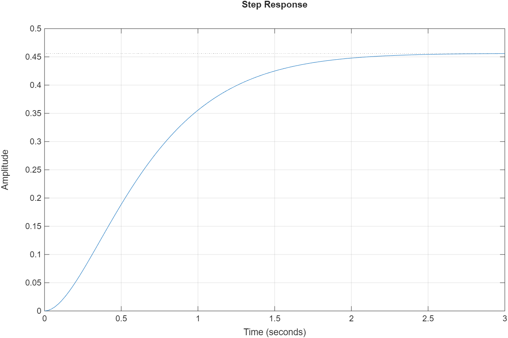{ width=83% }

For the free response with no external input,

$$x(t)=e^{At}x(0),\qquad y(t)=Ce^{At}x(0).$$

The original simulation uses $x(0)=[1\;1\;2]^{T}$. Because $A$ is Hurwitz, the initial-state component decays as time increases. The distinction between the forced step response and the free initial-condition response matters: a nonzero initial state can create a transient even when $u(t)=0$.

# Study 6 — unity negative feedback

For a strictly proper SISO plant with unity negative feedback and a reference acting at the summing junction, the closed-loop transfer function is

$$T(s)=\frac{G(s)}{1+G(s)}.$$

With $D=0$, the corresponding state realization is

$$\dot{x}=(A-BC)x+Br,\qquad y=Cx.$$

Here $r$ denotes the reference. The study examines new pole locations and the step response after closing the loop. Feedback changes the characteristic polynomial and may alter steady-state accuracy, transient speed, and damping. With the present model, the closed-loop final value for a unit step under unity feedback is $G(0)/(1+G(0))$, which is below one.

**Implementation note.** The archived Question 6 code uses `A - B*[1 1 1]` rather than `A - B*C`. The former is a feedback law from the sum of the chosen states and is not, in general, identical to unity **output** feedback. The original implementation is retained unchanged; this report states the theoretical unity-feedback relation separately and does not treat the two constructions as automatically equivalent.

# Study 7 — pole-placement state feedback

## General formulation

For the feedback law

$$u(t)=-Kx(t)+N_{r}r(t),$$

the state equation becomes

$$\dot{x}=(A-BK)x+BN_{r}r.$$

Because $(A,B)$ is controllable, a suitable row vector $K$ can place the eigenvalues of $A-BK$ at a desired stable set. MATLAB's `place` function is used in the project for this purpose.

## Real pole set

The first trial specifies

$$\mathcal{P}_{\mathrm{real}}=\{-2,-3,-6\}.$$

These values represent a stable nonoscillatory target spectrum. The project compares its closed-loop step response and `stepinfo` measures with the original plant, including rise and settling characteristics. It also plots internal state trajectories and a control-signal reconstruction.

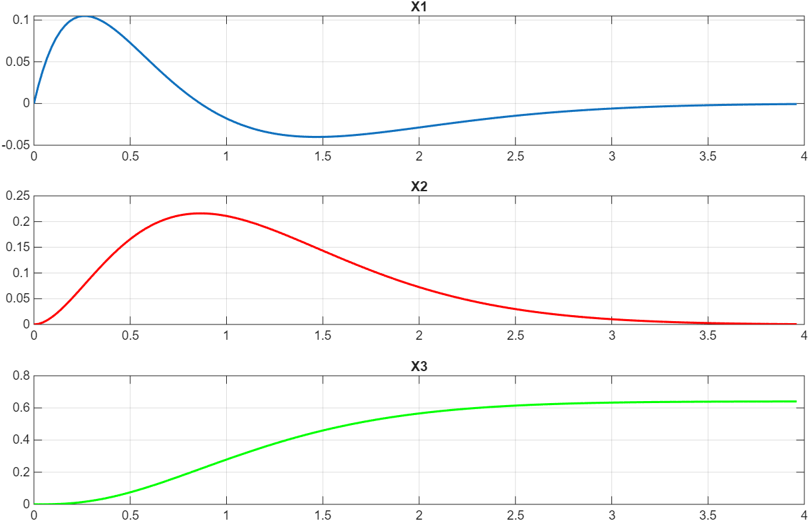{ width=79% }

## Complex-conjugate pole set

The second trial uses

$$\mathcal{P}_{\mathrm{complex}}=\{-2+j,\,-2-j,\,-2.5\}.$$

The conjugate pair introduces an oscillatory mode. The relative size of the real and imaginary parts controls its damping and oscillation frequency, while the additional real pole affects the remaining transient component. The project contrasts these results with the real-pole design.

The control action in a reference-tracking realization must include the reference contribution $N_r r$ when it is part of the simulated input. In one archived plot the reconstructed control input uses only $-Kx$; that particular trace should therefore be interpreted as a partial feedback contribution rather than an independently verified total actuator command.

# Study 8 — static reference precompensation

Pole placement can improve transient behavior without guaranteeing zero steady-state error for a step reference. A static precompensator supplies an input scaling factor, often written $N_r$, for a constant desired output.

For a stable closed-loop plant with $D=0$,

$$\dot{x}=(A-BK)x+BN_r r,\qquad y=Cx.$$

At a constant equilibrium, setting $\dot{x}=0$ gives

$$y_{\infty}=-C(A-BK)^{-1}B\,N_r r_{\infty}.$$

Consequently, provided the scalar inverse exists,

$$N_r=\left[-C(A-BK)^{-1}B\right]^{-1}.$$

The source code computes this factor (named `k3`) after selecting the real-pole set $\{-2,-3,-6\}$. The report shows the resulting step response, internal states, and control action. This method produces nominal zero step error for the modeled steady state but is sensitive to incorrect static plant gain: a fixed reference scale does not itself correct unknown disturbances or changes in equilibrium gain.

# Study 9 — integral reference tracking

To improve rejection of constant disturbances and remove constant-reference offset under suitable stability and reachability conditions, an integral state is introduced:

$$\dot{\xi}=r-y=r-Cx.$$

Define the augmented state $x_a=[x^T\;\xi]^T$. Its matrices are

$$
A_a=\begin{bmatrix}A&0\\-C&0\end{bmatrix},\qquad
B_a=\begin{bmatrix}B\\0\end{bmatrix},\qquad
E=\begin{bmatrix}0\\1\end{bmatrix}.
$$

The augmented dynamics and controller are

$$\dot{x}_a=A_ax_a+B_au+Er,\qquad u=-K_ax_a.$$

The MATLAB script uses an augmented order of four and the desired pole vector

$$\mathcal{P}_{\mathrm{int}}=\{-1.5,-1.6,-1.7,-1.8\}.$$

It computes the gain through `acker` and simulates the response using a forward-Euler update with a numerical step of $0.01$ s. The reported response approaches the reference for the nominal experiment. The mathematical reason is the integral state: if a stable equilibrium exists with bounded integrator state, then $\dot\xi=0$ implies $y=r$ for a constant setpoint.

This guarantee depends on closed-loop stability, non-saturation, and the model structure. It should not be interpreted as unconditional rejection of arbitrary time-varying disturbances or unstable parameter perturbations.

# Study 10 — static versus integral tracking under perturbations

The comparison considers the nominal tracking transient and several perturbation scenarios. The source script includes modifications to the state matrices, constant additive disturbances, and a disturbance that changes magnitude partway through the simulated horizon. The two methods express distinct philosophies: static precompensation corrects nominal reference gain, while integral action uses accumulated error to continually adjust the input.

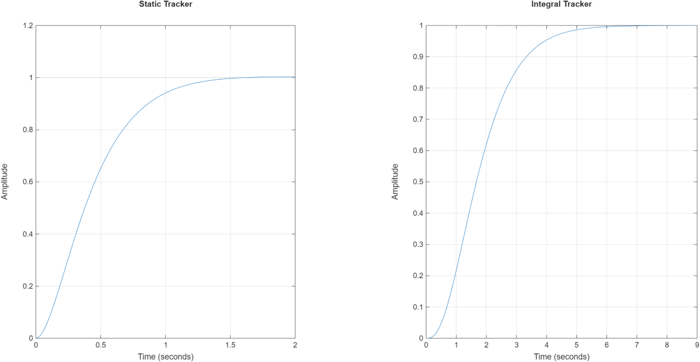{ width=88% }

## Nominal tracking

Both configurations are intended to reduce setpoint error in the nominal model. Differences in transient speed arise from the different selected pole sets and the augmented state associated with integral feedback. A fair comparison should therefore account not only for the presence of the integrator but also for the specific closed-loop eigenvalues used in each experiment.

## Parameter modifications

The original code adds selected perturbation matrices to the dynamics. These are exploratory numerical changes, not parameters estimated from a physical identification campaign. The report discusses cases where the integral tracker retains a favorable response and cases where a particular perturbation makes the augmented loop behave poorly. The appropriate conclusion is conditional robustness: integral tracking offers a mechanism for reducing steady offset but cannot ensure stability under arbitrary model uncertainty.

## Constant and changing disturbances

An additive state disturbance can be represented by

$$\dot{x}=Ax+Bu+Ed.$$

When $d$ is constant, the internal model supplied by an integrator can eliminate steady output error if the augmented closed loop remains stable and admits a consistent equilibrium. A time-varying disturbance is not generally canceled exactly. In the script, a disturbance increases around the midpoint of a ten-second simulation; the resulting plots illustrate dynamic rejection rather than a formal gain or bandwidth bound.

The original study is valuable as a comparative exploratory experiment. Because the different perturbation magnitudes and injection points are not a controlled benchmark, no single numerical robustness ranking is assigned here.

# Study 11 — full-order Luenberger observers

## Observer construction

Suppose the full state cannot be measured directly but $y=Cx$ is available. A full-order observer is

$$\dot{\hat{x}}=A\hat{x}+Bu+L(y-C\hat{x}).$$

For the estimation error $e=x-\hat{x}$ under a matched plant model,

$$\dot{e}=(A-LC)e.$$

If $(A,C)$ is observable, the eigenvalues of $A-LC$ can be placed through the dual state-feedback problem. The source uses `acker(A',C',p)'`.

Two observer pole sets are studied:

$$\mathcal{P}_{L,\mathrm{moderate}}=\{-4,-5,-6\},$$

$$\mathcal{P}_{L,\mathrm{fast}}=\{-10,-12,-15\}.$$

Faster poles should, in an ideal matched model, shorten the linear estimation-error transient. The trade-off is increased observer gain, which can amplify measurement noise and model mismatch.

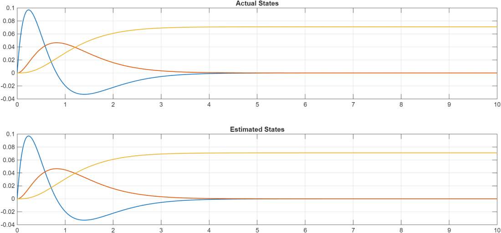{ width=85% }

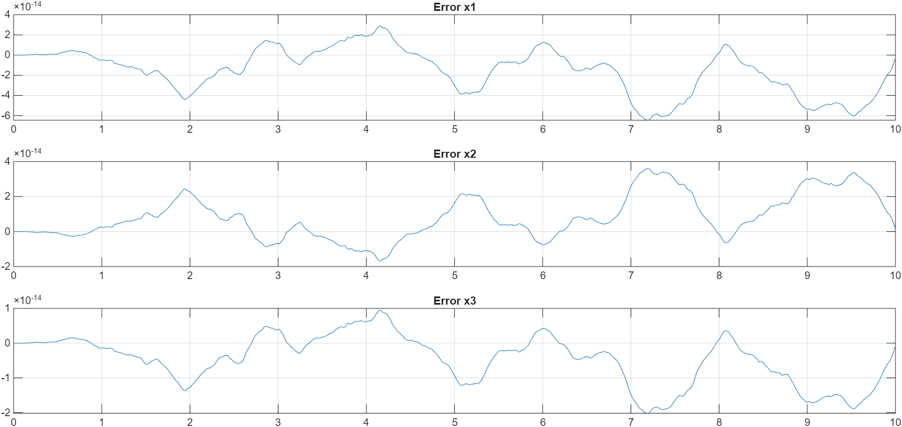{ width=83% }

**Interpretation caution.** Some observer simulations in the archived code initialize both the plant and observer with the same zero state and apply identical idealized inputs. This configuration may generate a zero or very small error without exercising recovery from a genuinely unknown initial state. Accordingly, a rigorous observer-convergence test should introduce $e(0)\neq0$; the original figures are retained as study outputs, not upgraded to that validation claim.

# Study 12 — sensitivity of full-order observation to model changes

The sensitivity study introduces a perturbed plant matrix

$$A_{p}=A+\Delta A,$$

and compares moderate and fast observer pole choices. With a fixed nominal observer using $A$, the error dynamics become

$$\dot{e}=(A-LC)e+\Delta A\,x,$$

for a simple additive state-matrix mismatch. This reveals why placing observer poles further left does not automatically provide universal robustness: the mismatch acts as a forcing term, and noise sensitivity can rise with gain magnitude.

The original source contains several perturbation constructions. In particular, one block uses the changed matrix in both the simulated plant and the observer dynamics. Such a case is better understood as a *changed-model observer study* rather than a strict test of an observer that continues to use an unchanged nominal model. The general mismatch equation above provides the benchmark against which the interpretation should be made.

A more complete sensitivity assessment would specify perturbation norms, initial estimation error, noise covariance, and error-performance measures. These were not consistently available in the submitted materials and are not fabricated here.

# Study 13 — reduced-order observation

If the plant has $n=3$ states and one independent measured output, the remaining state information can, under appropriate coordinate assumptions, be estimated using an observer of order $n-p=2$. This saves observer states but does not remove states from the physical plant.

Choose an invertible transformation $T$ such that

$$\bar{x}=Tx=\begin{bmatrix}y\\x_b\end{bmatrix},\qquad
\bar A=TAT^{-1}=\begin{bmatrix}A_{11}&A_{12}\\A_{21}&A_{22}\end{bmatrix},$$

$$\bar B=TB=\begin{bmatrix}B_1\\B_2\end{bmatrix}.$$

A reduced observer can estimate the unmeasured substate through a dynamic variable $z$ with reconstruction

$$\widehat{x}_b=z+L_r y.$$

The corresponding auxiliary dynamics for $D=0$ can be expressed as

$$
\dot{z}=(A_{22}-L_rA_{12})z
+\big[(A_{22}-L_rA_{12})L_r+A_{21}-L_rA_{11}\big]y
+(B_2-L_rB_1)u.
$$

The original reduced-order study selects poles $\{-1,-5\}$ and uses MATLAB's `place` on the dual pair involving $A_{22}$ and $A_{12}$. The transformed state and its estimate are plotted for comparison.

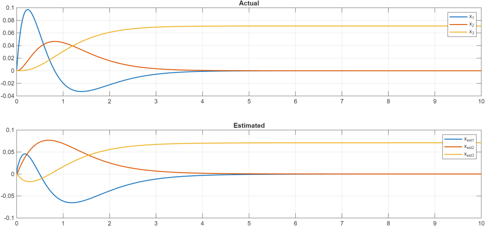{ width=84% }

The initial reduced-observer subsection in the archived script omits a term proportional to $-L_rA_{11}y$ in one auxiliary update; later sections use the fuller expression. This source-level detail is documented for reproducibility while the original code remains unchanged.

# Study 14 — full-order observer-based state feedback

State feedback assumes access to $x$, whereas an observer supplies an estimate $\hat x$. Combining the two leads to an estimated-state controller

$$u=-K\hat{x}+N_r r.$$

The observer and plant then evolve together:

$$\dot{x}=Ax+B(-K\hat{x}+N_r r),$$

$$\dot{\hat{x}}=A\hat{x}+Bu+L(y-C\hat{x}).$$

The controller poles in the original trial are $\{-2,-3,-6\}$, while the observer poles are $\{-10,-12,-15\}$. Under ideal LTI assumptions, the separation principle explains why a stabilizing state-feedback gain and a convergent observer can be designed separately: the combined characteristic eigenvalues are the union of the controller and estimator error eigenvalues in suitable coordinates.

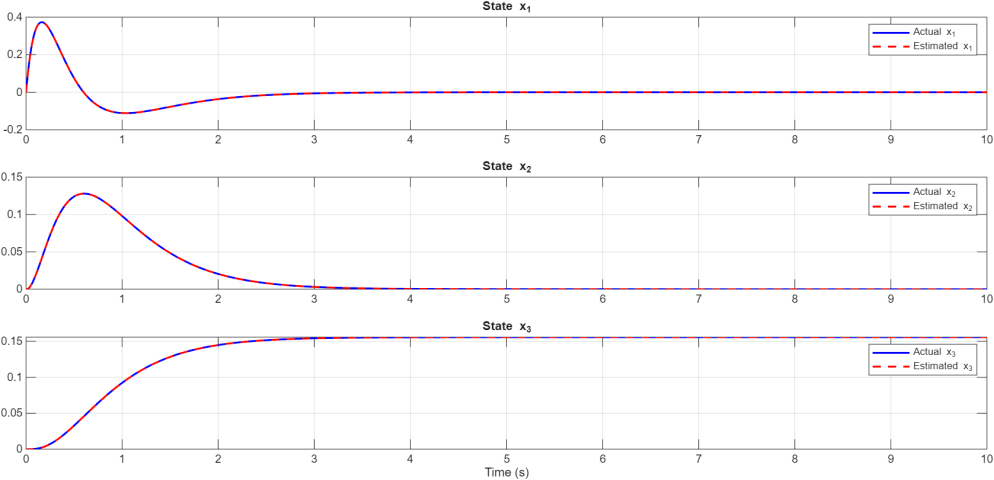{ width=81% }

The report records a regulated step output and state-estimate trajectories. The separation principle is a nominal stability result; it is not a guarantee that an observer-based controller will remain robust to large mismatch, delays, noise, or actuator constraints.

# Study 15 — feedback using a reduced-order observer

This section replaces the full three-state observer with the two-state estimation structure of Study 13. The control law uses a reconstructed full estimate,

$$u=-K\hat{x}+N_r r,$$

where $\hat{x}$ is assembled from the directly measured output and the reduced observer states. The original MATLAB script specifies controller poles $\{-3,-4,-5\}$ and reduced observer poles $\{-10,-12\}$.

The MATLAB implementation builds a coordinate transformation, partitions the transformed matrices, evolves the auxiliary observer state, and compares actual and estimated state trajectories. A reduced-order design may lower dynamic state count, but its derivation and implementation are more coordinate-dependent than the full-order observer.

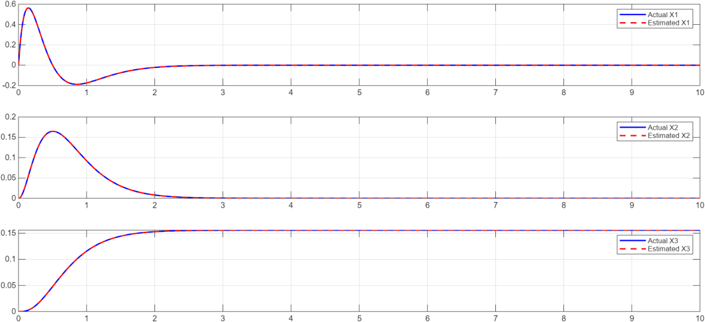{ width=82% }

The supplied script uses the MATLAB right-division notation `P*A/P` and `C/P` for expressions corresponding to $PAP^{-1}$ and $CP^{-1}$. The transformation must remain invertible for these expressions to be meaningful. The report records simulations of the combined loop, while complete independent numerical validation has not been performed for this portfolio edition.

# Study 16 — integral tracking with a full-order observer

The integral tracker of Study 9 is extended to the case where state feedback uses an estimate. With

$$\dot{\xi}=r-y,$$

the control command can be written

$$u=-K_x\hat{x}-K_i\xi.$$

The augmented plant pair used for placing tracking poles is

$$A_a=\begin{bmatrix}A&0\\-C&0\end{bmatrix},\qquad B_a=\begin{bmatrix}B\\0\end{bmatrix}.$$

The source chooses tracking poles $\{-3,-4,-5,-6\}$ and full-order observer poles $\{-10,-12,-15\}$. The MATLAB simulation evolves the plant, observer, and integral state in a numerical time loop, producing the tracked output and estimated versus true states.

This experiment integrates three ideas: pole placement, state estimation, and internal-model tracking. The intended nominal property is zero offset for a constant reference if the full augmented observer/controller system is stable. The available source figures support the existence of the simulated design workflow, not an independently measured general robustness guarantee.

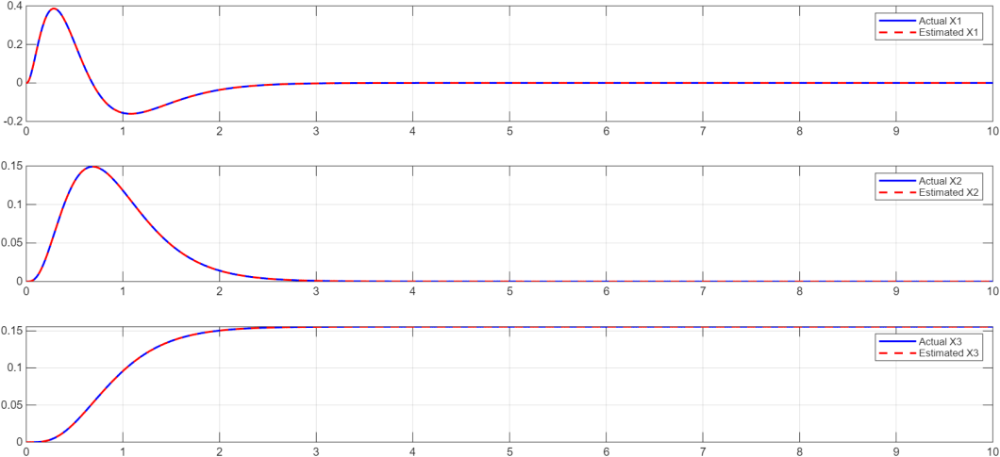{ width=83% }

# Study 17 — integral tracking with a reduced-order observer

The final estimator-based tracker combines the four-state *plant plus integral error* control design with a second-order reduced observer for the three plant states. The control structure is

$$u=-K_x\hat{x}-K_i\xi,\qquad\dot{\xi}=r-y.$$

The original code uses tracking poles $\{-3,-4,-5,-6\}$ and reduced-order observer poles $\{-10,-12\}$. State estimates are reconstructed through the coordinate transformation introduced earlier, and the feedback command is applied to the simulated plant.

This configuration is attractive when one output is directly measured but the other two states must be estimated. It combines nominal setpoint tracking with a lower-order estimator, at the price of careful transformations and increased sensitivity to implementation consistency.

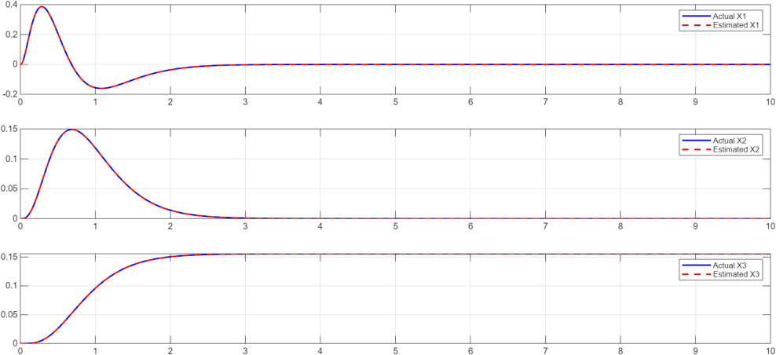{ width=83% }

The comparison with Study 16 is primarily architectural: full-order and reduced-order observers solve the same information problem using different state dimensions. The supplied report provides plots of both approaches but does not establish a controlled statistical comparison of observer noise sensitivity or computation time.

# Study 18 — Linear Quadratic Regulator (LQR)

## Quadratic optimal-control formulation

Pole placement specifies eigenvalues directly. In contrast, the infinite-horizon continuous-time LQR method selects feedback to minimize

$$J=\int_0^{\infty}\left[x(t)^TQx(t)+u(t)^TRu(t)\right]dt,$$

where $Q=Q^T\succeq0$ penalizes state deviation and $R=R^T\succ0$ penalizes input effort. Under the usual stabilizability and detectability assumptions, the stabilizing solution $S$ of the continuous-time algebraic Riccati equation satisfies

$$A^TS+SA-SBR^{-1}B^TS+Q=0,$$

and the optimal state-feedback gain is

$$K_{\mathrm{LQR}}=R^{-1}B^TS.$$

The MATLAB project uses `lqr(A,B,Q,R)` and then simulates closed-loop states. A separate DC-gain scaling factor is applied for the step-reference demonstrations. This scaling is an additional tracking adjustment; the basic LQR objective above is stated for state regulation.

## Varying the input penalty $R$

With $Q=I_3$ fixed, the script studies

$$R\in\{0.01,\;0.1,\;1,\;10,\;50,\;100,\;500\}.$$

A smaller $R$ assigns less cost to control effort and can produce more aggressive gains; a larger $R$ penalizes actuator usage more strongly. The effect on transient behavior is not reducible to an unqualified rule about every state and every metric, so the original work displays trajectories rather than asserting a universal ordering.

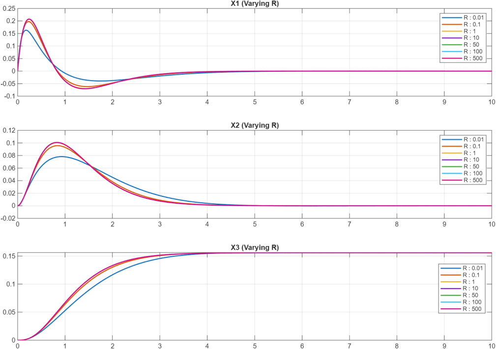{ width=90% }

## Varying the state penalty $Q$

With $R=1$ fixed, the original parameter sweep uses

$$Q=qI_3,\qquad q\in\{1,\;10,\;50,\;100,\;500,\;1000,\;5000\}.$$

Increasing $q$ increases the relative penalty on state deviation. Depending on the plant and the resulting Riccati solution, this often shifts the design toward tighter state regulation at the cost of increased control effort. A detailed performance assessment should compare both state trajectories and actual control-signal magnitude, not only the plotted outputs.

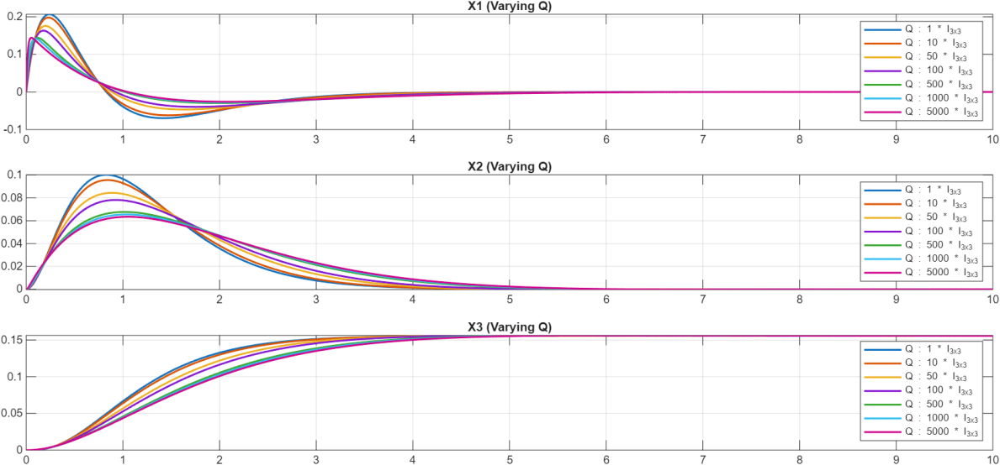{ width=90% }

The sweeps are particularly useful for understanding design trade-offs: unlike direct pole placement, LQR expresses a preference through a cost function. The choice of $Q$ and $R$ should ultimately reflect allowable state errors, actuator limits, operating conditions, and application-specific priorities.

# Comparative discussion

The overall project follows a cumulative design sequence. First, the transfer-function model is translated into a state representation. Structural checks establish a basis for both feedback and state estimation. Direct pole placement then shapes transient behavior; static reference scaling corrects nominal DC gain; integral tracking adds a state representing accumulated error. Observers address the practical fact that internal states may not all be measured, while LQR introduces an optimization-based alternative to manually chosen pole sets.

| Method | Primary design object | Principal strength | Qualification |
|:--|:--|:--|:--|
| Open-loop analysis | $G(s)$, pole-zero map | Characterizes nominal dynamics | No feedback disturbance rejection |
| Unity output feedback | $T(s)=G/(1+G)$ | Simple feedback architecture | Step offset may remain |
| State-feedback pole placement | $K$ | Direct eigenvalue assignment | Requires measured or estimated state |
| Static reference scaling | $N_r$ | Corrects nominal step gain | Sensitive to static model errors |
| Integral tracking | $K_x,K_i$ | Internal model for constant offset | Adds dynamics and stability constraints |
| Full-order observer | $L$, order three | Reconstructs all states | Noise and mismatch sensitivity |
| Reduced-order observer | $L_r$, order two | Uses measured output directly | More involved coordinate handling |
| Observer-based feedback | $K,L$ | Makes estimated-state control possible | Depends on estimation accuracy |
| LQR | $Q,R$ and Riccati solution | Explicit state-effort compromise | Weight selection remains a design decision |

The saved simulation images demonstrate the breadth of the completed coursework. The strongest contribution is the sustained progression from fundamental structural analysis to integrated controllers and observers. By comparison, the available evidence does not establish hardware implementation, repeated experimental trials, sensor-noise benchmarks, statistical confidence intervals, or a quantified hardware-performance specification.

# Reproducibility, numerical assumptions, and validation limits

The original MATLAB source is archived as a single script with numbered `%% Question` sections. It uses the Control System Toolbox commands `tf`, `tf2ss`, `ss`, `pole`, `zero`, `ctrb`, `obsv`, `minreal`, `place`, `acker`, `lqr`, `step`, `initial`, `lsim`, and `stepinfo`. Several custom state simulations use explicit forward Euler updates with $\Delta t=0.01$ s over a nominal 10 s window.

An Euler update has the form

$$x_{k+1}=x_k+\Delta t\,f(x_k,u_k).$$

It is an approximation to the continuous-time ODE, not an exact discrete-time state transition. Its accuracy depends on step size relative to the fastest dynamics, including fast observer poles. For a linear system, the exact zero-order-hold discretization would instead use $A_d=e^{A\Delta t}$ and the corresponding $B_d$ integral. No equivalence between Euler and exact simulation is asserted here.

Important source-level considerations are preserved as reproducibility notes rather than silently corrected in the original code:

1. The Question 6 matrix `A - B*[1 1 1]` is not the standard unity-output-feedback matrix `A-BC` for the present output matrix.
2. Some control-signal plots omit the reference-feedforward term even when the corresponding response model includes it.
3. Several full-order observer experiments use equal initial states for plant and observer, so convergence from a nonzero estimation error is not necessarily demonstrated.
4. Some model-variation simulations perturb both the actual and observer models, making the label *nominal-model mismatch* imprecise.
5. The earliest reduced-order auxiliary-state update does not include every term appearing in the standard derived transformation; subsequent combined designs use a fuller form.
6. The original simulations and reported interpretations have **not been rerun end-to-end in MATLAB for this English edition**. No new numerical performance scores are invented.

A future validation protocol could run each section independently with explicit initialization, test observer convergence for $e(0)\neq0$, check pole-placement residuals, compare exact and Euler integration, record $u(t)$ as well as $y(t)$, and benchmark controller performance under a shared perturbation design. These are recommended improvements, not completed work.

# Conclusion

This project demonstrates a broad, coherent application of modern linear control ideas to a fixed third-order plant. Its progression from state-space realization through controllability, observability, minimal realization, pole placement, reference tracking, state observers, combined estimator-based controllers, and LQR illustrates how internal-state methods allow more systematic control design than transfer-function inspection alone.

Static reference precompensation and integral action solve related but distinct tracking problems. Full- and reduced-order observers demonstrate different ways to use output measurements to supply missing state information. Combining observation with regulation or integral tracking builds implementable conceptual controller architectures. The LQR section closes the study by linking feedback gain selection to an explicit quadratic objective.

The primary contribution of this portfolio report is an organized, mathematically grounded interpretation of the **original eighteen-part MATLAB study**. The code and original results remain unchanged; methodological limitations and unresolved validation points are recorded openly. The document should be read as an extensive undergraduate analytical and simulation project, rather than as a claim of physical deployment or independently certified control performance.

# References and further reading

The following are standard subject references that provide theoretical background; their presence here does not imply that every numerical step of the original project was taken from these texts.

1. K. Ogata, *Modern Control Engineering*, 5th ed., Prentice Hall, 2010.
2. G. F. Franklin, J. D. Powell, and A. Emami-Naeini, *Feedback Control of Dynamic Systems*, 7th ed., Pearson, 2015.
3. C.-T. Chen, *Linear System Theory and Design*, 4th ed., Oxford University Press, 2012.
4. D. G. Luenberger, *An Introduction to Observers*, IEEE Transactions on Automatic Control, 16(6), 596-602, 1971.
5. R. E. Kalman, *Contributions to the Theory of Optimal Control*, Boletin de la Sociedad Matematica Mexicana, 5, 102-119, 1960.
6. MathWorks, *Control System Toolbox Documentation*: `tf2ss`, `place`, `acker`, `lqr`, `ctrb`, `obsv`, `stepinfo` (software command references).

# Appendix A — question-to-deliverable map

This table is reconstructed from the numbered MATLAB code sections and the available report. It is not presented as the original official question sheet.

| Source question | Main scope | Original evidence |
|--:|:--|:--|
| 1 | Transfer-function poles, zeros, stability | `pole`, `zero`, `pzmap`, `step` |
| 2 | State-space realization | `tf2ss` and matrix output |
| 3 | Controllability and observability | `ctrb`, `obsv`, `rank` |
| 4 | Minimal realization | `minreal` |
| 5 | Step and initial-condition response | `step`, `initial` |
| 6 | Feedback study | State matrix modification, response, poles, zeros |
| 7 | Real and complex pole placement | `place`, trajectories, control input |
| 8 | Static tracking | Precompensation and step response |
| 9 | Integral tracking | Four-state augmentation, `acker`, Euler simulation |
| 10 | Tracking robustness comparisons | Parameter changes and disturbances |
| 11 | Full-order observers | Two observer pole sets, estimate plots |
| 12 | Observer sensitivity | Perturbed plant matrices |
| 13 | Reduced-order observer | Similarity transform and order-two estimate |
| 14 | Full-order observer-based feedback | Combined plant-estimator-controller simulation |
| 15 | Reduced-order observer-based feedback | Estimated-state feedback with order-two observer |
| 16 | Integral tracking with full-order observer | Augmented controller plus estimator |
| 17 | Integral tracking with reduced-order observer | Augmented tracker plus reduced estimator |
| 18 | LQR | $Q$ and $R$ sweeps and state plots |

# Appendix B — project file integrity

The public portfolio repository keeps the original `matlab/code.m` without altering its source implementation. Figures included in this document are selections extracted from the original submitted report. Their purpose is to show what was documented in the earlier MATLAB investigation. They are not artificial reconstruction images and do not stand in for new independent re-execution.

The original Persian report is intentionally **not distributed in the public repository**, and the original editable Word file is excluded. The English academic PDF is the public-facing technical explanation. The official assignment handout is not included because it was not available.
